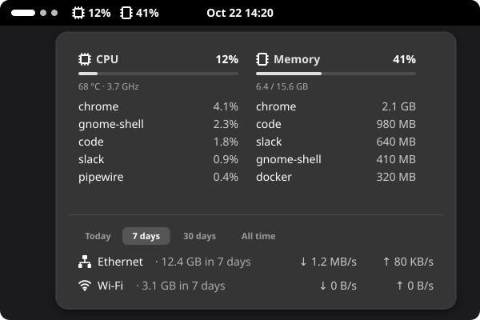
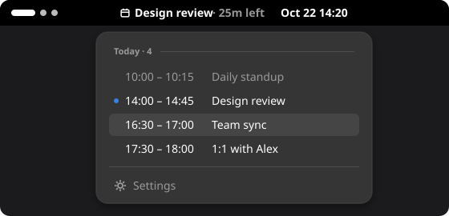
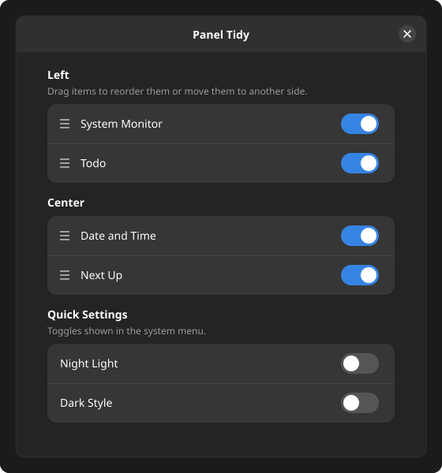

# gnome-extensions

My GNOME Shell extensions, for GNOME Shell 46 on Ubuntu 24.04 (X11). Some started from an
upstream project and are maintained here as my own code; the rest were written here. The
images below are mockups with made-up data.

| # | Extension | What it does | Based on | License |
|---|---|---|---|---|
| 1 | [System Monitor](extensions/system-monitor) | CPU and memory in the bar; top apps and network in the popup | [Resource Monitor](https://github.com/0ry0n/Resource_Monitor), [Network Stats](https://github.com/noroadsleft000/gnome-network-stats) | GPL-3.0 |
| 2 | [Next Up](extensions/next-up) | Next meeting in the bar; today's meetings in the popup | [gnome-next-up](https://github.com/artisticat1/gnome-next-up) | GPL-3.0 |
| 3 | [Todo](extensions/todo) | Plain task list in the bar | [Todo.txt](https://gitlab.com/todo.txt-gnome-shell-extension/todo-txt-gnome-shell-extension) | MIT |
| 4 | [Panel Tidy](extensions/panel-tidy) | Orders and hides top bar items and Quick Settings toggles | [Top Bar Organizer](https://gitlab.gnome.org/june/top-bar-organizer), [Just Perfection](https://gitlab.gnome.org/jrahmatzadeh/just-perfection) | MIT |
| 5 | [Window Layout](extensions/window-layout) | Puts windows back on the right monitor | - | MIT |

## System Monitor



CPU % and memory % in the top bar. The popup lists the top 5 apps by CPU and by memory,
the CPU temperature and frequency, and each cable / Wi-Fi interface with its speed and the
data it used today, in the last 7 or 30 days, or in total.
[More](extensions/system-monitor/README.md)

## Next Up



The next meeting of the day in the top bar, with a faded countdown, or the meeting in
progress with the time left. Clicking it lists today's meetings (past ones faded, the
current one marked); clicking a meeting opens the calendar app. Hidden when nothing is
left today. [More](extensions/next-up/README.md)

## Todo


The number of pending tasks in the top bar. In the popup, type a task and press Enter to
add it, click it to mark it done, ✕ to delete it, and drag it by its handle to change the
priority. [More](extensions/todo/README.md)

## Panel Tidy



Orders the top bar items across the left, center and right of the bar, and hides the bar
items and Quick Settings toggles you don't use, all from its preferences window.
[More](extensions/panel-tidy/README.md)

## Window Layout


With a side monitor, Slack takes its top 60% and Discord / ZapZap the bottom 40%; every
other window is maximized on the primary monitor. With one monitor, everything is
maximized. Runs when monitors change, when the shell starts, and on Super+Shift+W.
[More](extensions/window-layout/README.md)

## Install

Each extension is linked into the shell's extension folder, so the checked-out branch is
what runs:

```bash
name=system-monitor
glib-compile-schemas extensions/$name/schemas
ln -s "$PWD/extensions/$name" ~/.local/share/gnome-shell/extensions/$name@emanuel36
gnome-extensions enable $name@emanuel36
```

GNOME Shell caches extension code: after changing it, restart the shell (X11: Alt+F2, `r`)
or log out.

## Upstream imports

Next Up was imported from upstream and is kept up to date by hand.
The commit it was taken from:

| # | Directory | Upstream | Branch | Imported commit |
|---|---|---|---|---|
| 1 | `extensions/next-up` | [artisticat1/gnome-next-up](https://github.com/artisticat1/gnome-next-up) | `main` | `44707c4cbc1e` |

Other extensions were imported earlier and later removed, once replaced or no longer
used; their import is still in the git history: Resource Monitor, Network Stats, Top Bar
Organizer, Just Perfection, Todo.txt, Bluetooth Battery Meter, Clipboard History and
Speech2Text.

## Licensing

Every extension keeps its upstream license file and copyright notices in its own
directory, and my changes to an extension are released under that extension's license.
GPL-3.0 requires modified files to carry a notice saying they were changed, with the date.
