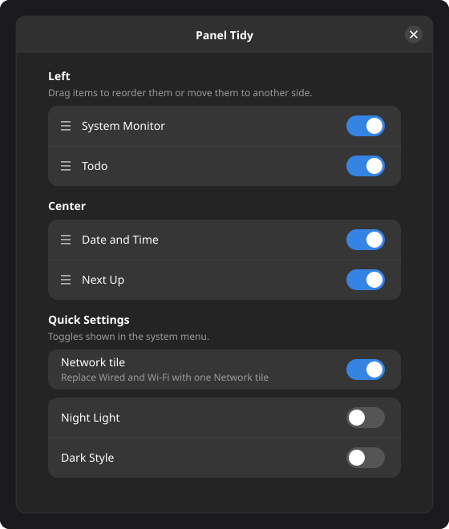

# Panel Tidy

Orders the top bar items across the left, center and right of the bar, and hides the top
bar items and Quick Settings toggles you don't use. Everything is set in its preferences
window (drag rows to reorder, switches to show or hide) and applies immediately.

Other extensions keep working exactly as without it. A new item is shown where its
extension put it and then appears in the preferences window. App tray icons are
remembered across app restarts, and an app counts as one item whichever kind of tray icon
it shows. Disabling Panel Tidy shows everything it hid.

A few extensions place their button on the bar in an unusual way; those are not listed.

Replaces Top Bar Organizer and Just Perfection.

## License

MIT, see `LICENSE`.
