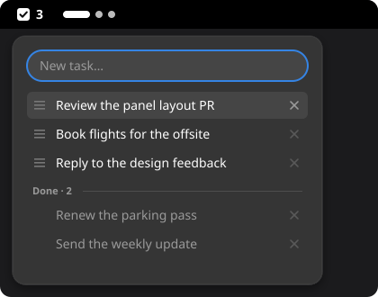

# Todo

A plain task list in the top bar, which shows how many tasks are pending. In the popup:

- type a task and press Enter to add it on top;
- click a task to move it to Done, and click it again to bring it back;
- ✕ deletes a task;
- drag a pending task by its handle to change the order: the order is the priority.

Tasks are kept in `~/.local/share/todo@emanuel36/tasks.json`. If that file gets damaged,
it is set aside as `tasks.json.bad` and the list starts empty.

Replaces Todo.txt, with a much simpler list; no code was copied from it.

## License

MIT, see `LICENSE`.
