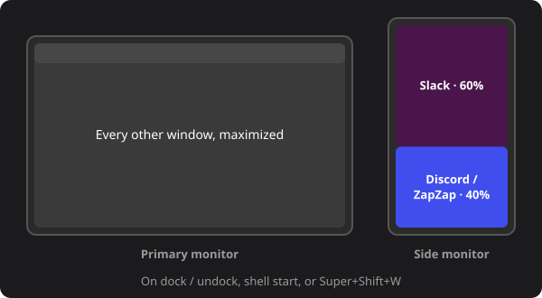
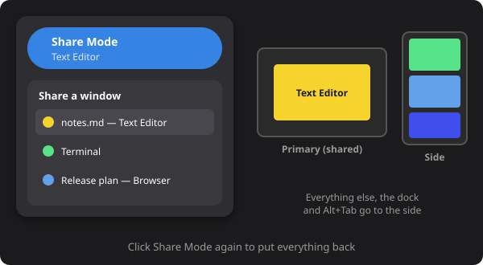

# Window Layout

Puts windows back where they belong when monitors change:

- with a side monitor, Slack takes its top 60% and Discord / ZapZap the bottom 40%; every
  other window is maximized on the primary monitor;
- with one monitor, everything is maximized.

It runs when a monitor is plugged in or removed, when GNOME Shell starts, and on
Super+Shift+W.

## Share Mode

Leaves only the window you are sharing in a call on the primary monitor. Open Quick
Settings, open the **Share Mode** menu and pick the window. While it is on:

- every other window moves to the side monitor, and new windows open there;
- the dock and the Alt+Tab switcher move to the side monitor;
- notifications are cleared and new ones show no banners;
- the automatic layout above is paused.

Click **Share Mode** again to put windows, the dock and notifications back as they were.
It needs two monitors, and turns itself off when a monitor is plugged in or removed.

Written from scratch.

## License

MIT, see `LICENSE`.
