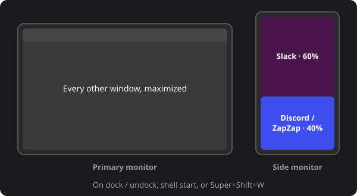

# Window Layout

Puts windows back where they belong when monitors change:

- with a side monitor, Slack takes its top 60% and Discord / ZapZap the bottom 40%; every
  other window is maximized on the primary monitor;
- with one monitor, everything is maximized.

It runs when a monitor is plugged in or removed, when GNOME Shell starts, and on
Super+Shift+W.

Written from scratch.

## License

MIT, see `LICENSE`.
